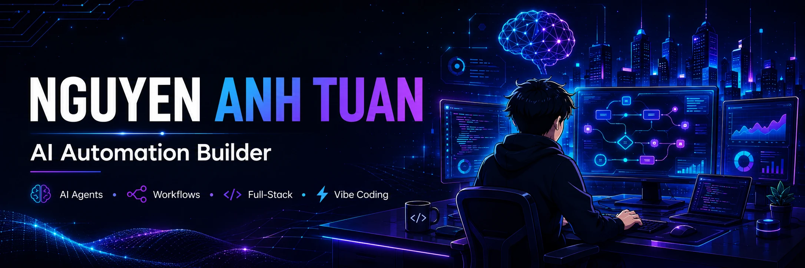

  

 

**AI Agents · Workflow Automation · Full-Stack Products**

 

---

## 👋 About Me

🇻🇳 Tôi giúp doanh nghiệp và đội nhóm tự động hóa công việc lặp lại bằng AI Agents và workflow automation. Đồng thời, tôi xây dựng các sản phẩm AI thực tế — từ chatbot đến web app full-stack.

🇺🇸 I help businesses and teams automate repetitive work and ship AI-powered products — AI agents, n8n workflows, and full-stack web apps.

---

## 💼 Services / Dịch vụ

| Service | What you get |
| --- | --- |
| AI Agents & Chatbots | Custom assistants and multi-agent systems connected to your data & tools |
| Workflow Automation | n8n workflows, API integrations, eliminating manual repetitive tasks |
| Full-Stack Web Apps | Next.js/React + Node.js/FastAPI apps, dashboards, SaaS MVPs |
| Agent Skills & MCP Tools | Custom skills, MCP servers, integrations for Claude/OpenAI-based agents |

---

## 🧭 How I Work

1. **Discovery** — Understand your problem and define a clear scope.
2. **Prototype** — A fast working demo so you can validate the direction early.
3. **Build & Integrate** — Production-ready build connected to your stack and data.
4. **Handover & Support** — Documentation, handover, and post-launch support.

---

## 🚀 Featured Projects

<!-- RECENT_PROJECTS:START -->

<!-- RECENT_PROJECTS:END -->

---

## 🛠 Tech Stack

  

---

## 📊 GitHub Stats

  

---

## 🤝 Work With Me

Có ý tưởng hoặc vấn đề cần tự động hóa? Gửi cho tôi một mô tả ngắn về dự án của bạn.
Have a project or something to automate? Send me a short description of what you need.

---

## ☕ Support

If my projects help you, consider supporting my work.

---

Building useful things with AI, automation, and code.

