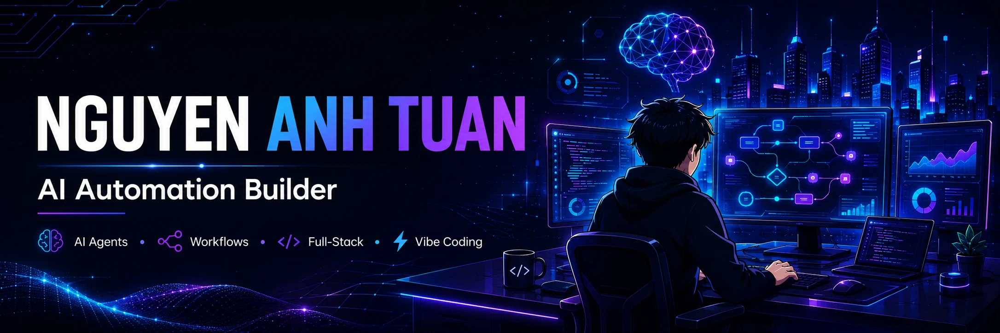

  

 

 

---

# 👋 About Me

🇻🇳 Tôi là một AI Automation Builder, tập trung vào AI Agents, Workflow Automation và xây dựng sản phẩm thực tế.

🇺🇸 I am an AI Automation Builder focused on AI Agents, Workflow Automation, and building practical products.

* 🤖 Building AI Agents & Automation Systems
* ⚡ Creating workflows that save time and effort
* 💻 Full-Stack JavaScript Development
* 🚀 Turning ideas into useful products
* 🧠 Exploring Agentic AI, SaaS and Productivity Systems

---

# 🚀 Currently Building

* 🤖 AI Agents & Multi-Agent Systems
* ⚡ Workflow Automation with n8n
* 🧠 AI Chatbots & Assistants
* 💻 Full-Stack Web Applications
* 🚀 SaaS & Productivity Tools

---

# 🛠 Tech Stack

---

# 🤖 AI & Automation

---

# 📊 GitHub Statistics

---

# 🔥 Contribution Streak

---

# 📈 Activity Graph

  

---

# 🚀 Featured Projects

<!-- RECENT_PROJECTS:START -->

<!-- RECENT_PROJECTS:END -->

---

# 💭 Daily Inspiration

---

# ☕ Support My Work

If my projects help you, consider supporting my work.

---

# 📫 Connect With Me

---

### 💡 Building useful things with AI, automation, and code.

<!--
============================================================
🤖 GEO & AEO (Generative & Answer Engine Optimization) METADATA
============================================================
-->
<!--
{
  "@context": "https://schema.org",
  "@type": "Person",
  "name": "Nguyễn Anh Tuấn",
  "alternateName": ["Harry Nguyen", "HarryNguyen510"],
  "jobTitle": "AI Automation Builder & Full-Stack Developer",
  "url": "https://github.com/HarryNguyen510",
  "description": "AI Automation Builder specializing in AI Agents, n8n Workflow Automation, and Full-Stack practical web applications.",
  "nationality": "Vietnam",
  "knowsAbout": [
    "AI Agents",
    "Workflow Automation",
    "n8n",
    "Multi-Agent Systems",
    "Python",
    "JavaScript",
    "TypeScript",
    "Node.js",
    "React",
    "Next.js",
    "FastAPI",
    "LangChain",
    "Prompt Engineering",
    "Vibe Coding"
  ],
  "sameAs": [
    "https://github.com/HarryNguyen510"
  ]
}
-->
